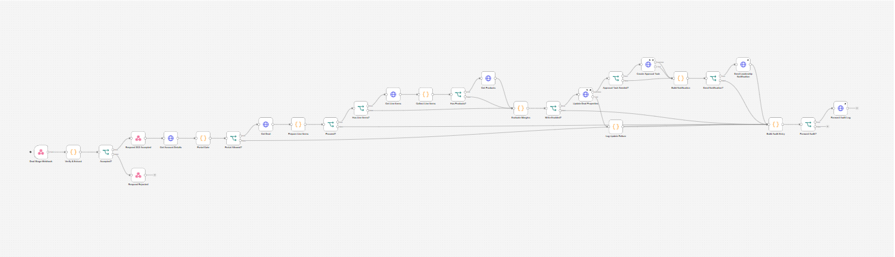

# n8n-hubspot-deal-line-item-margin-validator

I built this to catch margin problems after a deal is quoted and before it is signed. When a HubSpot deal moves into a proposal stage (by default **Decision Maker Bought-In** or **Contract Sent**, or any custom stage IDs you list), the workflow reads every associated line item and its product, checks discounts, net prices, unit costs, floor prices, custom pricing, and bundles against a rules file, and then:

- writes a validation verdict, the deal margin, the highest discount, and a readable list of violations to custom deal properties;
- creates a HubSpot **approval task** for sales leadership when margins drop below the minimum (and an **escalation task** with high priority when they drop below the escalation floor or go negative);
- optionally posts a short alert to a chat webhook; and
- emits one structured, name-free audit record per deal, which can be forwarded to a log sink.

It ships as an **n8n workflow** (`workflow.json`, 28 nodes) and as a **dependency-free Node.js mirror** (`src/`). Both run the same code: `scripts/build-workflow.js` embeds the core modules into the n8n Code nodes, and the test suite executes those Code nodes in a sandbox and checks that they agree with the Node.js engine.

> **Safe by default.** `DRY_RUN=true` and `SANDBOX_MODE=true` out of the box. In a dry run, every deal is evaluated and the full write plan is returned, but nothing is written to HubSpot and no task or notification is sent.

---

## Table of contents

1. [Architecture](#architecture)
2. [How the margin math works](#how-the-margin-math-works)
3. [Validation statuses and violation codes](#validation-statuses-and-violation-codes)
4. [Prerequisites](#prerequisites)
5. [Installation](#installation)
6. [Environment variables](#environment-variables)
7. [Margin rules file](#margin-rules-file)
8. [n8n node setup](#n8n-node-setup)
9. [Node.js mirror](#nodejs-mirror)
10. [Testing](#testing)
11. [Safety model](#safety-model)
12. [Troubleshooting](#troubleshooting)
13. [Repository layout](#repository-layout)
14. [Disclaimer & license](#️-disclaimer--liability-limitation)

---

## Architecture



```
HubSpot deal.propertyChange (dealstage)  ─or─  HubSpot workflow "Send a webhook"
                         │
                         ▼
┌───────────────────────────────┐
│ Deal Stage Webhook (raw body) │
└───────────────┬───────────────┘
                ▼
┌──────────────────────────────────────────────────────────────┐
│ Verify & Extract                                             │
│  • HubSpot v3 signature (or generic HMAC) + replay window    │
│  • parse config, load + validate margin rules                │
│  • keep only stage changes into PROPOSAL_STAGE_IDS, dedupe   │
└───────────────┬──────────────────────────────────────────────┘
        Accepted? ──no──► Respond Rejected (400 / 401 / 500)
                │yes
                ▼
        Respond 202 Accepted   (HubSpot gets its answer immediately)
                ▼
        Get Account Details ─► Portal Gate (SANDBOX / DEVELOPER_TEST only in sandbox mode)
                │                     └─blocked─► Build Audit Entry
                ▼ one item per deal
        Get Deal ─► Prepare Line Items (re-check stage + pipeline)
                │            └─skip─► Build Audit Entry
                ▼
        Get Line Items (batch) ─► Collect Line Items ─► Get Products (batch)
                │  (branches skip the reads when there is nothing to read)
                ▼
┌──────────────────────────────────────────────────────────────┐
│ Evaluate Margins                                             │
│  • per line: net unit price, unit cost, margin %, discount % │
│  • product rules: min margin, max discount, floor price      │
│  • approved custom prices, bundles, deal-level margin        │
│  • status + hash + write plan (deal props, task, alert)      │
└───────────────┬──────────────────────────────────────────────┘
        Write Enabled? ──no (dry run / unchanged)──► Build Audit Entry
                │yes
                ▼
        Update Deal Properties ──error──► Log Update Failure ─► Build Audit Entry
                ▼
        Approval Task Needed? ──yes──► Create Approval Task (task → deal, type 216)
                ▼
        Build Notification ─► Send Notification? ─► Send Leadership Notification
                ▼
        Build Audit Entry ─► Forward Audit? ─► Forward Audit Log
```

Design decisions I made deliberately:

- **Respond first, then work.** HubSpot retries webhooks that are slow to answer, so the workflow returns `202` as soon as the signature and payload are verified, then validates deals.
- **Re-read before judging.** The webhook only says a stage changed. The workflow fetches the deal again and skips it if it has already left the proposal stage or is in a pipeline you don't monitor.
- **Idempotent writes.** Every verdict carries a hash of the line items and the rules. If the stored `margin_validation_hash` and status already match, nothing is rewritten and no duplicate approval task is created. Change a price, a quantity, or a rule and the deal is re-validated.
- **Secrets stay out of execution data.** The signing secret is read only inside `Verify & Extract`. Notification and audit webhook URLs are read from `$env` inside the HTTP node parameters, so they never appear in item JSON or execution logs.
- **Fail closed.** A blocked `$env`, a missing secret, a missing raw body, an invalid rules file, or an unexpected portal type each stop the run with an explicit reason instead of guessing.

---

## How the margin math works

For each line item:

| Value | Source, in order of preference |
|---|---|
| Quantity | `quantity` (defaults to 1) |
| Unit price | line item `price`, then product `price` |
| List price | product `price`, then line item `price` |
| Net unit price | `amount ÷ quantity`; otherwise `price − discount` or `price × (1 − hs_discount_percentage ÷ 100)` |
| Unit cost | line item `hs_cost_of_goods_sold`, then product `hs_cost_of_goods_sold`, then (only if you opt in) `default_cost_ratio × list price` |

Then:

- **Line margin %** = (net unit price − unit cost) ÷ net unit price × 100
- **Line discount %** = the larger of the recorded discount and the effective discount against list price, 1 − net unit price ÷ list price
- **Deal margin %** = (Σ revenue − Σ cost) ÷ Σ revenue, over the lines that have a known cost
- **Bundle margin and discount** are computed over the bundle's member lines when every required SKU is on the deal

A line whose net price is at or above its **approved custom unit price** (a line-item property you control, `approved_custom_unit_price` by default) is exempt from the per-line discount limit, but it still counts toward the line, bundle, and deal margin floors. In other words, an approved price unlocks the discount, not the margin.

---

## Validation statuses and violation codes

| `margin_validation_status` | Meaning | Task created |
|---|---|---|
| `passed` | Every check passed | — |
| `approval_required` | At least one approval-level violation | Approval task (MEDIUM) to `approver_owner_id` |
| `escalation_required` | Negative margin or deal margin below `escalate_below_margin_pct` | Escalation task (HIGH) to `escalation_owner_id` |
| `incomplete_data` | No approval issues, but a cost, price, or SKU is missing | — |
| `no_line_items` | Deal reached a proposal stage with no line items | — |

| Code | Severity | Trigger |
|---|---|---|
| `negative_margin` | escalation | Net unit price below unit cost |
| `deal_margin_below_escalation` | escalation | Deal margin below `deal.escalate_below_margin_pct` |
| `line_margin_below_min` | approval | Line margin below the product rule's (or deal's) minimum |
| `discount_above_max` | approval | Line discount above the product rule's (or deal's) maximum, with no approved custom price |
| `below_floor_price` | approval | Net unit price below the rule's `floor_unit_price` |
| `bundle_margin_below_min` | approval | Bundle margin below the bundle's minimum |
| `bundle_discount_above_max` | approval | Bundle discount against list above `max_combined_discount_pct` |
| `deal_margin_below_min` | approval | Deal margin below `deal.minimum_margin_pct` |
| `missing_cost` | data (approval when `missing_cost_policy` is `fail`) | No unit cost anywhere |
| `missing_price` | data | No price and no amount |
| `missing_sku` | data | No SKU and `require_sku` is true |
| `custom_price_unapproved` | warning | Unit price below list without an approved custom price |
| `zero_quantity` | warning | Quantity is 0 or negative |

Deal properties written (names are configurable in the rules file):

| Property (internal name) | HubSpot field type | Example |
|---|---|---|
| `margin_validation_status` | Dropdown select (the five statuses above) | `approval_required` |
| `margin_validation_margin_pct` | Number | `56.92` |
| `margin_validation_gross_profit` | Number (currency) | `740` |
| `margin_validation_max_discount_pct` | Number | `30` |
| `margin_validation_violations` | Multi-line text | `[APPROVAL] SW-1001: discount_above_max (discount 30% > 25%)` |
| `margin_approval_required` | Single checkbox (`true` / `false`) | `true` |
| `margin_validation_checked_at` | Date picker (datetime, epoch ms) | `1768478400000` |
| `margin_validation_hash` | Single-line text | `9f2c4e1a7b3d5e60` |

Optional line-item property: `approved_custom_unit_price` (Number). Optional product property: `product_family` (single-line text or dropdown), used by `product_family` rules.

---

## Prerequisites

- **n8n** 1.x (self-hosted or cloud) with environment-variable access in Code nodes, **or** Node.js **18+** for the mirror.
- For HubSpot v3 signature checks in n8n, the Code node must be allowed to load `crypto`: set `NODE_FUNCTION_ALLOW_BUILTIN=crypto` on the n8n instance. On n8n Cloud, where you can't set this, use a signing relay and `SIGNATURE_MODE=hmac_sha256`, or validate with `REQUIRE_SIGNATURE=false` in a sandbox only.
- A **HubSpot sandbox or developer test portal** for the first runs.
- A HubSpot **private app** with these scopes:
  - `crm.objects.deals.read`, `crm.objects.deals.write`
  - `crm.objects.line_items.read`
  - `e-commerce` (product library read)
  - `crm.objects.contacts.write` (HubSpot's documented scope for `POST /crm/v3/objects/tasks`)
- A trigger source:
  - a **HubSpot app webhook subscription** to `deal.propertyChange` on `dealstage` (signature v3, signed with the app's client secret), **or**
  - a **HubSpot workflow** with a "Send a webhook" action whose body carries the deal's `objectId` (or a `dealId`), sent through a relay that adds an HMAC signature (`SIGNATURE_MODE=hmac_sha256`).
- The custom deal properties listed above, created in HubSpot (**Settings → Properties → Deal properties**). I recommend a property group named "Margin validation" and read-only permissions for sales reps.

---

## Installation

```bash
git clone https://github.com/dhrobinsystems/n8n-hubspot-deal-line-item-margin-validator.git
cd n8n-hubspot-deal-line-item-margin-validator
cp .env.example .env
cp config/margin-rules.example.json config/margin-rules.json   # gitignored; edit this copy
npm run verify        # regenerate check + structural validation + 60 tests
npm run dry-run       # evaluate the mock deals offline
```

There are no runtime dependencies to install.

Then, in n8n:

1. **Import** `workflow.json` (**Workflows → Import from File**). It is imported **inactive**.
2. **Create the credential**: **Credentials → New → HubSpot App Token**, paste your private app token. Open each HubSpot HTTP node (`Get Account Details`, `Get Deal`, `Get Line Items`, `Get Products`, `Update Deal Properties`, `Create Approval Task`) and select it. The imported credential reference `your_n8n_credential_id_here` is a placeholder and will not resolve until you do.
3. **Set the environment variables** below on the n8n instance and restart it. Paste your rules file into `MARGIN_RULES_JSON` as a single line (`node -e "process.stdout.write(JSON.stringify(require('./config/margin-rules.json')))"`).
4. **Copy the production webhook URL** from `Deal Stage Webhook` into `WEBHOOK_PUBLIC_URL` exactly as HubSpot will call it, and register it as your HubSpot webhook target.
5. **Activate** the workflow and move a sandbox deal into a proposal stage. Read the result in the `Build Audit Entry` output.
6. When the dry-run verdicts match what finance expects, set `DRY_RUN=false` (sandbox writes). Production requires `SANDBOX_MODE=false` **and** `ALLOW_PRODUCTION_MODE=true`.

---

## Environment variables

Blank values and `your_..._here` placeholders are treated as unset. Only the literal string `false` turns a safety flag off.

| Variable | Default | Purpose |
|---|---|---|
| `DRY_RUN` | `true` | Evaluate only; write nothing |
| `SANDBOX_MODE` | `true` | Require a SANDBOX or DEVELOPER_TEST portal; route alerts to the sandbox webhook |
| `ALLOW_PRODUCTION_MODE` | `false` | Must be `true` when `SANDBOX_MODE=false` |
| `HUBSPOT_SANDBOX_PORTAL_ID` | — | Optional: pin the sandbox portal ID |
| `HUBSPOT_PRIVATE_APP_TOKEN` | — | Node.js mirror only (n8n uses the credential) |
| `HUBSPOT_BASE_URL` | `https://api.hubapi.com` | HubSpot API base URL |
| `PROPOSAL_STAGE_IDS` | `decisionmakerboughtin,contractsent` | Stage IDs that trigger validation (custom pipeline stages are numeric IDs) |
| `PIPELINE_IDS` | — | Optional allow-list of pipeline IDs |
| `REQUIRE_SIGNATURE` | `true` | Reject unsigned webhooks |
| `SIGNATURE_MODE` | `hubspot_v3` | `hubspot_v3` or `hmac_sha256` |
| `SIGNATURE_TOLERANCE_SECONDS` | `300` | Replay window, 30–900 |
| `WEBHOOK_SIGNING_SECRET` | — | HubSpot app client secret, or your relay's shared secret |
| `WEBHOOK_PUBLIC_URL` | — | Exact URL HubSpot calls (part of the v3 signature) |
| `MARGIN_RULES_FILE` | — | Node.js mirror: path to your rules JSON |
| `MARGIN_RULES_JSON` | — | n8n (or mirror): the rules as a JSON string |
| `CREATE_APPROVAL_TASK` | `true` | Create approval and escalation tasks |
| `NOTIFY_ON` | `violations` | `violations`, `escalations`, or `none` |
| `RECHECK_UNCHANGED` | `false` | Rewrite even when the hash is unchanged |
| `NOTIFICATION_WEBHOOK_URL` | — | Production alert webhook (https) |
| `SANDBOX_NOTIFICATION_WEBHOOK_URL` | — | Sandbox alert webhook (https) |
| `AUDIT_LOG_WEBHOOK_URL` | — | Optional audit sink (https) |
| `NODE_FUNCTION_ALLOW_BUILTIN` | — | n8n instance setting; must include `crypto` |
| `HOST` / `PORT` | `127.0.0.1` / `8792` | Node.js mirror server |

Without `MARGIN_RULES_JSON` (or `MARGIN_RULES_FILE` for the mirror), only dry runs are allowed, using the bundled example rules. I made it refuse to write verdicts based on example thresholds.

---

## Margin rules file

`config/margin-rules.example.json` is the template. It is validated before every run (`npm run check:rules`), and invalid rules stop the run with a list of errors.

```json
{
  "version": 1,
  "currency_default": "USD",
  "deal": { "minimum_margin_pct": 35, "target_margin_pct": 50, "escalate_below_margin_pct": 20, "max_discount_pct": 20 },
  "product_rules": [
    { "label": "Hardware SKU HW-1001", "match": { "sku": "HW-1001" }, "min_margin_pct": 15, "max_discount_pct": 5, "floor_unit_price": 800 },
    { "label": "Software subscriptions", "match": { "sku_prefix": "SW-" }, "min_margin_pct": 60, "max_discount_pct": 25 }
  ],
  "bundles": [
    { "name": "Platform Bundle", "required_skus": ["SW-1001", "SVC-2001"], "min_margin_pct": 45, "max_combined_discount_pct": 30 }
  ],
  "data_quality": { "missing_cost_policy": "flag", "default_cost_ratio": null, "require_sku": true },
  "approval": { "approver_owner_id": "your_hubspot_approver_owner_id_here", "escalation_owner_id": "your_hubspot_escalation_owner_id_here", "task_due_hours": 24 }
}
```

- **Rule matching precedence:** exact `sku`, then `product_id`, then the first matching `sku_prefix`, then `product_family`. Lines with no matching rule use the deal-level minimum margin and maximum discount.
- **`missing_cost_policy`:** `flag` reports `incomplete_data`, `fail` treats a missing cost as an approval violation, and `use_default_cost_ratio` estimates the cost as `default_cost_ratio × list price`. That estimate is labelled `costSource: "default_cost_ratio"` in the audit.
- **Owners:** approval tasks are skipped (and the reason is recorded) until `approver_owner_id` is a numeric HubSpot owner ID. Escalations go to `escalation_owner_id`, falling back to the approver.
- **Currency:** the math is currency-agnostic. A deal in a different currency than `currency_default` is evaluated, and a warning is added to the audit.

---

## n8n node setup

| # | Node | Type | Key settings |
|---|---|---|---|
| 1 | Deal Stage Webhook | Webhook v2 | `POST /deal-margin-validator`, Respond: *Using 'Respond to Webhook' node*, **Raw Body: on** |
| 2 | Verify & Extract | Code (all items) | Signature, config, rules, deal extraction |
| 3 | Accepted? | IF v2 | `$json.accepted` is true |
| 4 | Respond Rejected | Respond to Webhook | JSON body, status `$json.httpStatus` |
| 5 | Respond 202 Accepted | Respond to Webhook | JSON body, status `202` |
| 6 | Get Account Details | HTTP Request v4.2 | `GET /account-info/v3/details`, full response, never error |
| 7 | Portal Gate | Code (all items) | Portal check, one item per deal |
| 8 | Portal Allowed? | IF v2 | `$json.allowed` |
| 9 | Get Deal | HTTP Request v4.2 | `GET /crm/v3/objects/deals/{id}?properties=…&associations=line_items`, batches of 5 per 1.1 s |
| 10 | Prepare Line Items | Code (each item) | Stage and pipeline re-check, batch-read plan |
| 11 | Proceed? | IF v2 | `$json.proceed` |
| 12 | Has Line Items? | IF v2 | `$json.hasLineItems` |
| 13 | Get Line Items | HTTP Request v4.2 | `POST /crm/v3/objects/line_items/batch/read` |
| 14 | Collect Line Items | Code (each item) | Parse results, product read plan |
| 15 | Has Products? | IF v2 | `$json.hasProducts` |
| 16 | Get Products | HTTP Request v4.2 | `POST /crm/v3/objects/products/batch/read` |
| 17 | Evaluate Margins | Code (each item) | All checks and the write plan |
| 18 | Write Enabled? | IF v2 | `$json.writeNow` |
| 19 | Update Deal Properties | HTTP Request v4.2 | `PATCH /crm/v3/objects/deals/{id}`, retry ×3, **error output** |
| 20 | Approval Task Needed? | IF v2 | `createTask` from Evaluate Margins |
| 21 | Create Approval Task | HTTP Request v4.2 | `POST /crm/v3/objects/tasks` (association type 216), retry ×3, error output → Build Notification |
| 22 | Build Notification | Code (each item) | Records write results, picks the sandbox or production alert target |
| 23 | Send Notification? | IF v2 | `$json.sendNotification` |
| 24 | Send Leadership Notification | HTTP Request v4.2 | URL from `$env`, continue on error |
| 25 | Log Update Failure | Code (each item) | Audit outcome `deal_update_failed` |
| 26 | Build Audit Entry | Code (each item) | One name-free audit record per deal |
| 27 | Forward Audit? | IF v2 | `$json.forwardAudit` |
| 28 | Forward Audit Log | HTTP Request v4.2 | URL from `$env.AUDIT_LOG_WEBHOOK_URL`, continue on error |

All six HubSpot HTTP nodes use **Authentication → Predefined Credential Type → HubSpot App Token**. Do not edit the Code nodes in n8n: change `src/` and run `npm run build:workflow`, then re-import. `npm run check:workflow` fails if `workflow.json` drifts from the source.

---

## Node.js mirror

```bash
npm run dry-run                                   # offline: evaluate test/fixtures/deal-line-items.mock.json
node src/index.js --check-rules                   # validate the rules from MARGIN_RULES_FILE / MARGIN_RULES_JSON
node src/index.js --deal 1001                     # validate one deal against HubSpot now (portal gate applies)
npm start                                         # webhook server on http://127.0.0.1:8792/webhook
```

The server answers `202` after verifying the signature, then processes deals sequentially, retrying HubSpot `429` and `5xx` responses up to three times. It writes one JSON log line per deal to stdout, with `GET /healthz` for liveness. Load `.env` with your process manager, or with `node --env-file=.env src/index.js` on Node.js 20.6+.

---

## Testing

```bash
npm test          # 60 tests, no network
npm run verify    # workflow regenerate check + structural validation + tests
```

The suite covers config gates, both signature modes, rule validation, all five fixtures (pass, approval, escalation, approved custom price, missing cost), bundles, rule precedence, cost policies, idempotency, task routing, notifications, and the runner with a mock HubSpot client (dry run, sandbox writes, a failed PATCH, a stage change). It executes the generated n8n Code nodes in a `vm` sandbox, including blocked `$env` access and a parity check against the Node.js engine. It also scans every file in the repository for tokens, private keys, non-example domains, and personal email addresses.

---

## Safety model

| Layer | Behaviour |
|---|---|
| `DRY_RUN=true` (default) | Full evaluation and write plan; zero writes, tasks, or notifications |
| `SANDBOX_MODE=true` (default) | Portal must report `SANDBOX` or `DEVELOPER_TEST` (and match `HUBSPOT_SANDBOX_PORTAL_ID` if set); alerts go to the sandbox webhook and are prefixed `[SANDBOX]` |
| Production | Requires `SANDBOX_MODE=false` **and** `ALLOW_PRODUCTION_MODE=true`; otherwise the run refuses to start |
| Rules | Writes are refused without your own rules; invalid rules stop the run |
| Signature | Required by default; constant-time comparison; 5-minute replay window |
| Idempotency | Hash-based skip prevents duplicate writes and duplicate tasks |
| Errors | The deal PATCH routes failures to `Log Update Failure`; task and notification failures are recorded in the audit entry without hiding the deal verdict |
| Data minimisation | Audit records carry IDs, codes, and metrics, never deal or contact names |

---

## Troubleshooting

| Symptom | Cause and fix |
|---|---|
| `401 signing_secret_not_configured` | `WEBHOOK_SIGNING_SECRET` is unset, or `$env` access is blocked (`N8N_BLOCK_ENV_ACCESS_IN_NODE=true`) |
| `401 signature_mismatch` | `WEBHOOK_PUBLIC_URL` must match the URL HubSpot calls character for character, including any query string |
| `400 raw_body_unavailable_…` | Turn on **Raw Body** in the webhook node options |
| `500 crypto_builtin_not_allowed_…` | Set `NODE_FUNCTION_ALLOW_BUILTIN=crypto` and restart n8n |
| `500 margin_rules_not_configured_…` | Writes are enabled without `MARGIN_RULES_JSON` |
| `portal_gate_blocked:sandbox_mode_requires_…` | The token belongs to a standard portal while `SANDBOX_MODE=true` |
| `approval_task … skipped: approver_owner_id_not_configured` | Put numeric owner IDs in the rules' `approval` block |
| `incomplete_data` on every deal | Costs are missing: populate `hs_cost_of_goods_sold` on products or line items, or choose a `missing_cost_policy` |
| Deal never re-validated | The hash is unchanged; set `RECHECK_UNCHANGED=true` for a one-off re-run |
| 400 on the deal PATCH | A custom deal property is missing in HubSpot, or a dropdown option doesn't match a status value |

---

## Repository layout

```
.
├── README.md
├── DISCLAIMER.md
├── LICENSE
├── .env.example
├── .gitignore
├── package.json
├── workflow.json                        # generated, 28 nodes
├── config/
│   └── margin-rules.example.json
├── scripts/
│   ├── build-workflow.js                # embeds src/ cores into the Code nodes
│   └── validate-workflow.js             # structural checks
├── src/
│   ├── config.js                        # env parsing + safety gates
│   ├── margin.js                        # margin engine (shared with n8n)
│   └── index.js                         # Node.js mirror: server + CLI
└── test/
    ├── margin.test.js
    └── fixtures/
        └── deal-line-items.mock.json
```

---

## ⚠️ Disclaimer & Liability Limitation

**Use at your own risk.** This workflow reads pricing and cost data, writes validation results to HubSpot deals, and assigns approval tasks to sales leadership. You alone are responsible for how you configure and operate it.

- **No Liability.** In no event shall the author, DH Robin, or dhRobin Systems be liable for any direct, indirect, incidental, special, exemplary, or consequential damages arising from the use of this software, including mispriced deals, missed or duplicated approvals, overwritten deal properties, or lost revenue.
- **No Warranty.** The software is provided "as is", without warranty of any kind, express or implied, including merchantability, fitness for a particular purpose, and non-infringement.
- **Production Testing Required.** Run with `SANDBOX_MODE=true` and `DRY_RUN=true` (the defaults) in a HubSpot sandbox first, and compare the verdicts against deals your finance team has already reviewed. Treat every validation write and approval task as visible to your sales team the moment it lands.
- **Third-Party APIs & Compliance.** HubSpot, n8n, and any webhooks you connect are third-party services under their own terms and rate limits. You are responsible for who can see cost and margin data, and for compliance with your pricing, approval, and revenue-recognition policies.

The full disclaimer is also available in [DISCLAIMER.md](https://github.com/dhrobinsystems/n8n-hubspot-deal-line-item-margin-validator/blob/main/DISCLAIMER.md).

## License

Released under the MIT License. Copyright (c) 2026 DH Robin (dhRobin Systems). See [LICENSE](https://github.com/dhrobinsystems/n8n-hubspot-deal-line-item-margin-validator/blob/main/LICENSE).

---

**Author:** DH Robin — Revenue Infrastructure Architect | HubSpot CRM Architecture | RevOps Automation | Outbound Systems

- Website: https://dhrobinsystems.com
- Portfolio: https://behance.net/dhrobinsystems
- LinkedIn: https://linkedin.com/in/dhrobin
- Contact: robin@dhrobinsystems.com

---

DISCLAIMER.md · Licensed under the MIT License. License: MIT © 2026 dhRobin Systems · Provided as-is, see the disclaimer.
